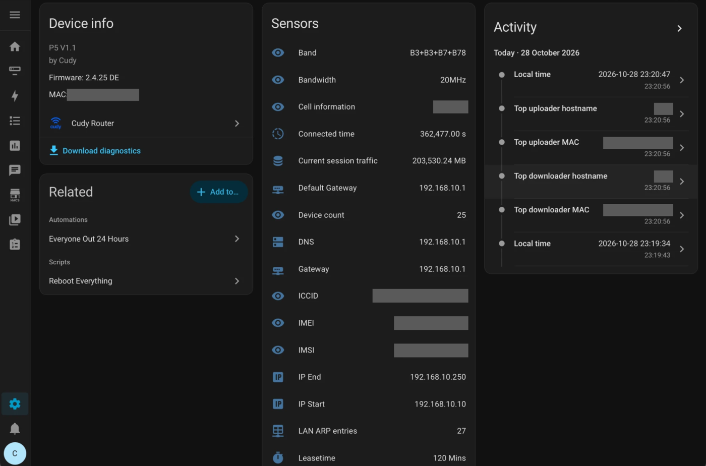
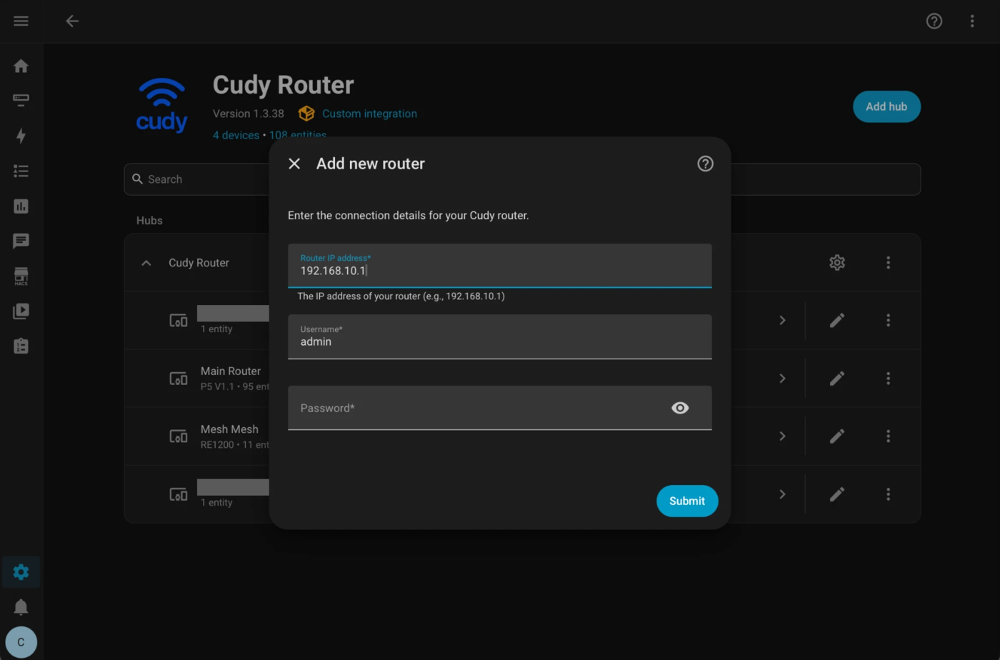
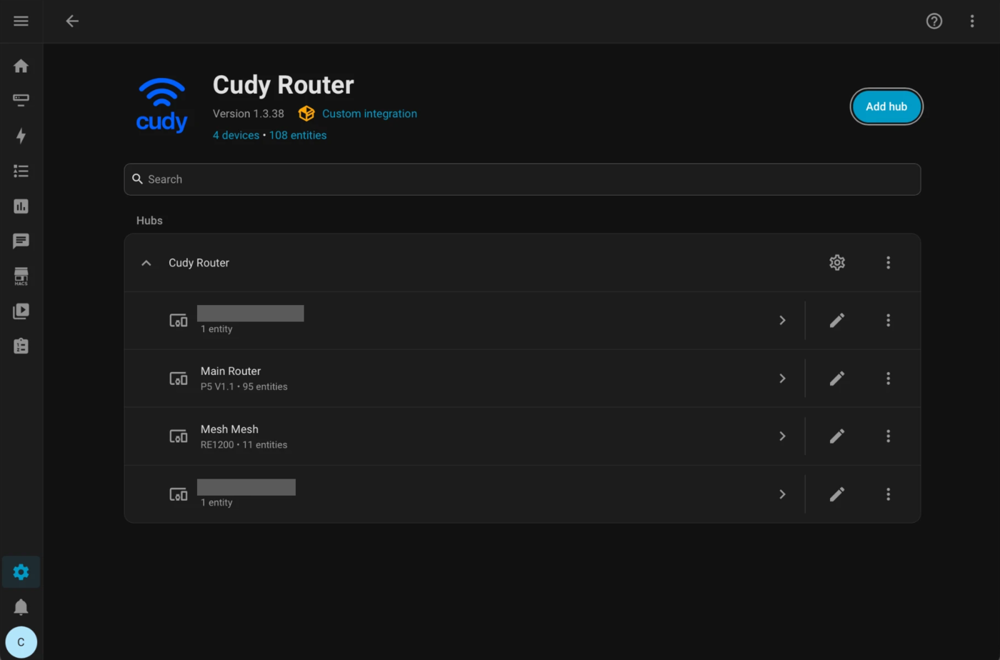
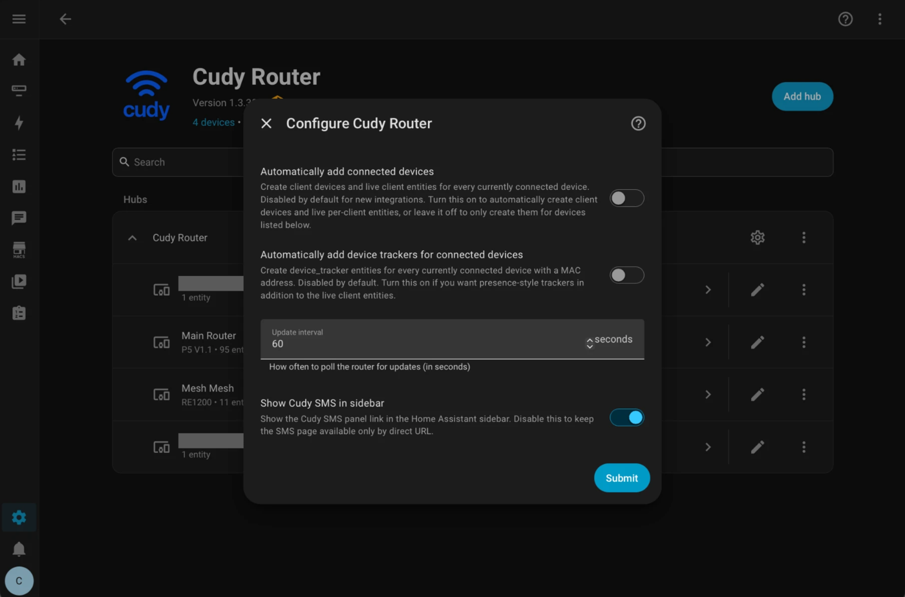
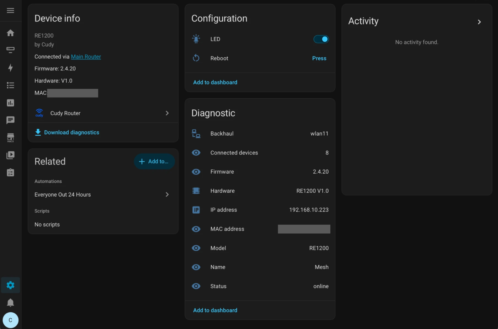
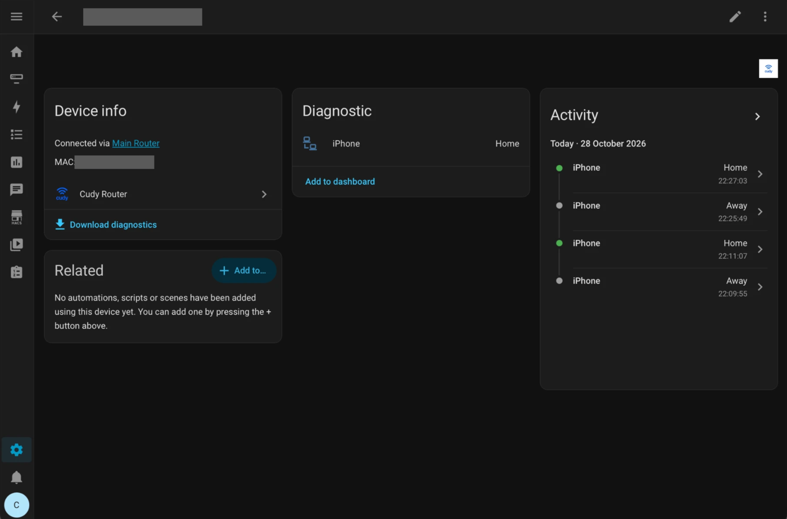
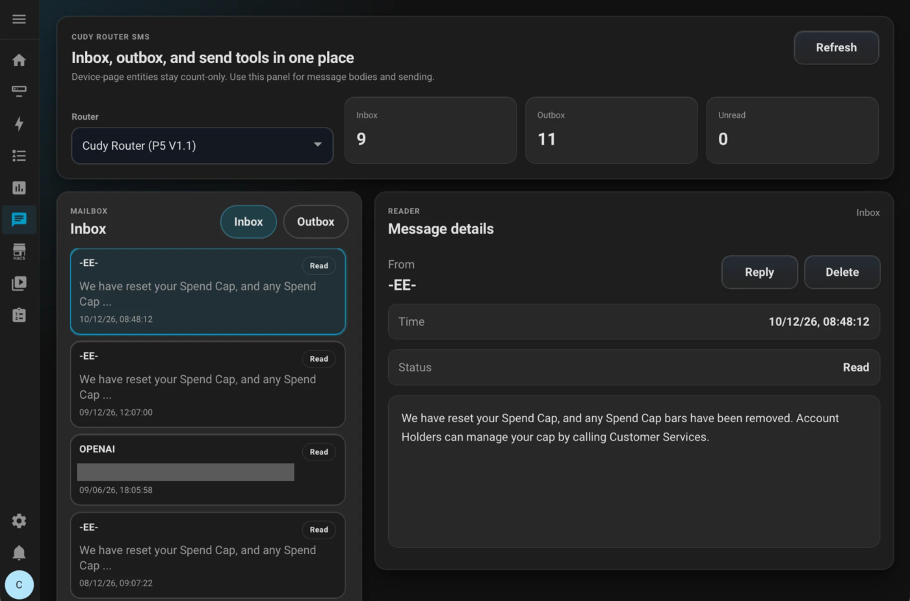
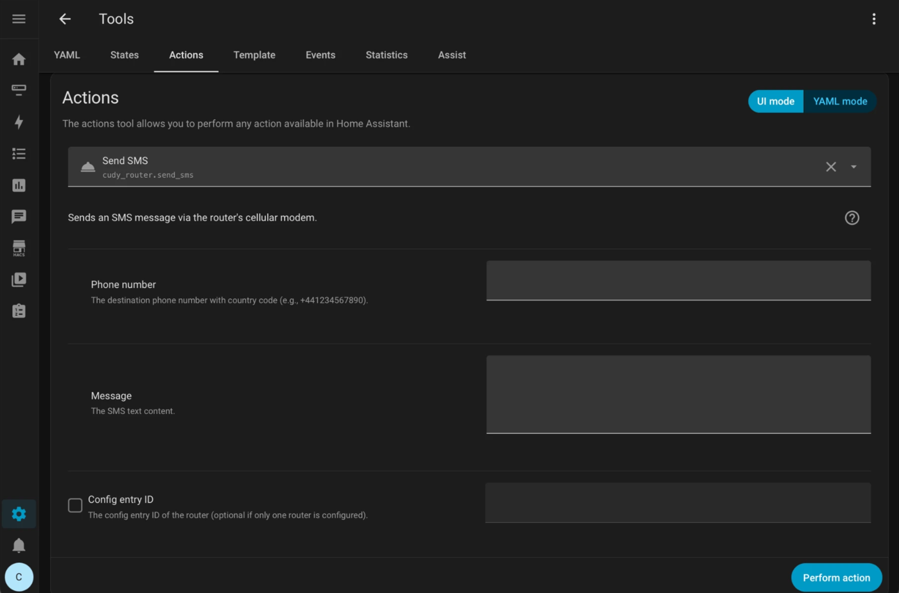
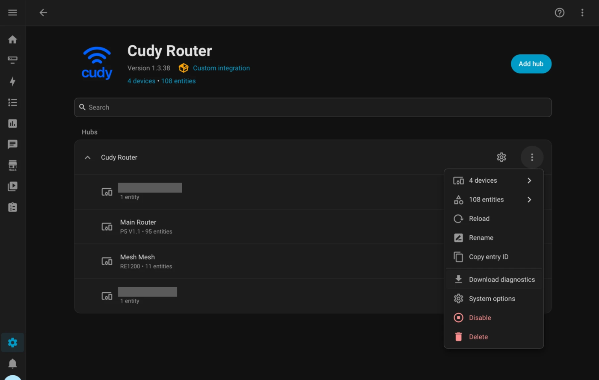

# Cudy Router for Home Assistant

`cudy_router` is a community-built Home Assistant integration for Cudy routers that expose a LuCI-based web interface.

It connects directly to the router over your local network, reads the same status and configuration pages you see in the browser, and turns them into Home Assistant entities, devices, and services.

## Why use it?

- **See what your network is doing:** signal strength, WAN status, traffic, CPU/RAM, and who is connected.
- **Control it from automations:** pause a device's internet access, switch Wi-Fi or VPN, or reboot the router on a schedule.
- **Stay on top of mobile broadband:** get notified when the 5G signal drops, restart the connection, or switch bands.
- **Handle SMS in Home Assistant:** read and send messages from a built-in panel or from automations.

## Highlights

- Local polling integration with config flow and options flow. No cloud, no account.
- Router-wide sensors for modem/cellular, WAN, LAN, DHCP, VPN, load balancing, Wi-Fi, SMS, traffic, and system status, including CPU/RAM usage when the router reports it.
- Writable router settings as `switch` and `select` entities, where the router supports them.
- Mesh node support with separate devices, per-node LED control, and per-node reboot.
- Connected client devices with per-client controls and optional `device_tracker` entities.
- WISP uplink scan and connect on supported models.
- Reboot buttons and services for SMS, AT commands, 5G connection restart, and band switching.
- Automatic config entry migration from older versions.

## Current Status

| Level | Models |
| --- | --- |
| Tested on real hardware | Cudy P5, Cudy P4 |
| Mapped from emulator or firmware page behavior | Several other routers, 4G/5G routers, mesh devices, and extenders |
| Unknown models | Best-effort dynamic detection |

The **Cudy P5** and **Cudy P4** have been tested on real hardware.

The integration includes a model capability map so unsupported module families stay hidden instead of showing dead or non-functional entities.

Other mapped models have **not** been tested on real hardware yet. See the [supported routers and compatibility guide](https://github.com/usersaynoso/ha-cudy-router/wiki/Supported-Routers-and-Compatibility) for the full list. If you try one, please share a [compatibility report](https://github.com/usersaynoso/ha-cudy-router/wiki/Router-Compatibility-Reports).

## Requirements

- A Cudy router with the LuCI web interface, reachable from Home Assistant on your local network.
- The router's admin username and password. They are stored in Home Assistant and only sent to your router; see [Privacy and Security](https://github.com/usersaynoso/ha-cudy-router/wiki/Privacy-and-Security).

## Installation

### HACS

Use the button above to open this repository directly in HACS, then download **Cudy Router** and restart Home Assistant.

If the button does not work:

1. Open **HACS** in Home Assistant.
2. Open the menu in the top-right corner.
3. Choose **Custom repositories**.
4. Add `https://github.com/usersaynoso/ha-cudy-router` as an **Integration** repository.
5. Search for **Cudy Router** in HACS and install it.
6. Restart Home Assistant.

### Manual

1. Copy `custom_components/cudy_router` into your Home Assistant `custom_components` directory.
2. Restart Home Assistant.

## Setup

1. Go to **Settings > Devices & Services**.
2. Add the **Cudy Router** integration.
3. Enter the router IP address, username, and password.
4. Your router appears as a device within a minute, with its entities grouped underneath.

The integration normalizes the host automatically. If you enter `192.168.10.1`, it will probe the router and store the working scheme as either `http://192.168.10.1` or `https://192.168.10.1`.

## Options

Open **Settings > Devices & Services > Cudy Router > Configure** to change:

| Option | Default | What it does |
| --- | --- | --- |
| Automatically add connected devices | Off | Creates client devices and live per-client entities for every connected device. When off, pick specific clients manually. |
| Automatically add device trackers | Off | Creates `device_tracker` entities for connected devices with a MAC address. Automatic connected-device cleanup does not remove trackers. |
| Show Cudy SMS in sidebar | On | Shows the SMS panel link in the sidebar. The panel stays available by URL when off. |
| Update interval | 60 seconds | How often the router is polled, in seconds. |

## What It Creates

The integration creates entities on these Home Assistant platforms: `sensor`, `switch`, `select`, `button`, `text`, and `device_tracker`.

Entity availability depends on the router model and firmware. Not every router exposes every page or field.

- **Main router device:** modem/cellular, WAN, traffic, system, CPU/RAM usage when supported, SMS, Wi-Fi, LAN, DHCP, VPN, load balancing, Mesh devices connected, settings, diagnostics, and reboot controls.
- **Mesh node devices:** node identity, firmware, status, IP address, backhaul, connected-device count, LED control, and reboot controls.
- **Connected client devices:** IP address, connection type, signal, online time, internet access, DNS filter, VPN control, and optional tracking.
- **SMS panel:** SMS-capable routers expose an admin-only sidebar panel at `/cudy-router-sms` for inbox, outbox, replies, and composing SMS messages.
- **WISP (supported models):** a **WISP scan** button, a **WISP network** picker, a write-only **WISP password** field, and a **WISP connect** button.

Screenshots: mesh node, connected client, and SMS panel

## Services

- `cudy_router.reboot_router`
- `cudy_router.restart_5g_connection`
- `cudy_router.switch_5g_band`
- `cudy_router.send_sms`
- `cudy_router.send_at_command`
- `cudy_router.generate_debug_report` (diagnostics; see Troubleshooting)

Use the optional `entry_id` field to target a specific router when you have multiple Cudy Router entries. See [Services and Example Calls](https://github.com/usersaynoso/ha-cudy-router/wiki/Services-and-Example-Calls) for examples.

## Full Documentation

The detailed user guide lives in the [GitHub wiki](https://github.com/usersaynoso/ha-cudy-router/wiki):

- **Getting started:** [Installation and Setup](https://github.com/usersaynoso/ha-cudy-router/wiki/Installation-and-Setup), [First Run Checklist](https://github.com/usersaynoso/ha-cudy-router/wiki/First-Run-Checklist), [Updating, Removing, and Reinstalling](https://github.com/usersaynoso/ha-cudy-router/wiki/Updating-Removing-and-Reinstalling)
- **Daily use:** [Entities and Device Model](https://github.com/usersaynoso/ha-cudy-router/wiki/Entities-and-Device-Model), [Entity Naming and Finding Entities](https://github.com/usersaynoso/ha-cudy-router/wiki/Entity-Naming-and-Finding-Entities), [Options and Device Trackers](https://github.com/usersaynoso/ha-cudy-router/wiki/Options-and-Device-Trackers), [Connected Devices Explained](https://github.com/usersaynoso/ha-cudy-router/wiki/Connected-Devices-Explained), [Services and Example Calls](https://github.com/usersaynoso/ha-cudy-router/wiki/Services-and-Example-Calls), [Common Automations](https://github.com/usersaynoso/ha-cudy-router/wiki/Common-Automations), [Dashboard Examples](https://github.com/usersaynoso/ha-cudy-router/wiki/Dashboard-Examples), [SMS Panel](https://github.com/usersaynoso/ha-cudy-router/wiki/SMS-Panel)
- **Support:** [Troubleshooting and Diagnostics](https://github.com/usersaynoso/ha-cudy-router/wiki/Troubleshooting-and-Diagnostics), [Troubleshooting by Symptom](https://github.com/usersaynoso/ha-cudy-router/wiki/Troubleshooting-by-Symptom), [Error Messages and Repairs](https://github.com/usersaynoso/ha-cudy-router/wiki/Error-Messages-and-Repairs), [FAQ](https://github.com/usersaynoso/ha-cudy-router/wiki/FAQ), [Known Limitations and Firmware Quirks](https://github.com/usersaynoso/ha-cudy-router/wiki/Known-Limitations-and-Firmware-Quirks), [Privacy and Security](https://github.com/usersaynoso/ha-cudy-router/wiki/Privacy-and-Security)
- **Compatibility and releases:** [Supported Model Matrix](https://github.com/usersaynoso/ha-cudy-router/wiki/Supported-Model-Matrix), [Supported Routers and Compatibility](https://github.com/usersaynoso/ha-cudy-router/wiki/Supported-Routers-and-Compatibility), [Router Compatibility Reports](https://github.com/usersaynoso/ha-cudy-router/wiki/Router-Compatibility-Reports), [Network Setup Examples](https://github.com/usersaynoso/ha-cudy-router/wiki/Network-Setup-Examples), [Release Notes and Upgrade Guide](https://github.com/usersaynoso/ha-cudy-router/wiki/Release-Notes-and-Upgrade-Guide), [Maintainer and Contributor Guide](https://github.com/usersaynoso/ha-cudy-router/wiki/Maintainer-and-Contributor-Guide)

## Known Limitations

- Not every model or firmware exposes every page, so some entities will not appear on every router.
- Some controls only exist on specific models (for example SMS, 5G band switching, WISP, and mesh).
- See [Known Limitations and Firmware Quirks](https://github.com/usersaynoso/ha-cudy-router/wiki/Known-Limitations-and-Firmware-Quirks) for details.

## Troubleshooting

If entities are missing, check that your router model exposes the relevant page or control and that the integration options for automatic or manual client creation are set correctly.

For router-specific entity, WAN, VPN, SMS, mesh, or settings issues, run the `cudy_router.generate_debug_report` action from Home Assistant Developer Tools when a maintainer asks for a live endpoint probe report. It can take a few minutes on some routers, returns a redacted Markdown report, and writes the same report to the Home Assistant log between `CUDY_ROUTER_DEBUG_REPORT_START` and `CUDY_ROUTER_DEBUG_REPORT_END`.

Please use the [bug report form](https://github.com/usersaynoso/ha-cudy-router/issues/new?template=bug_report.yml) and attach the Home Assistant diagnostics file for the Cudy Router integration.

To download diagnostics, open Home Assistant and go to **Settings > Devices & services > Cudy Router**, use the three-dot menu on the affected Cudy Router entry, then choose **Download diagnostics**. Keep the Home Assistant tab open and avoid opening the diagnostics download URL in a new tab, because that can return `401: Unauthorized`. Standard diagnostics use cached integration data so the download can return quickly.

## Contributing

Issues and pull requests are welcome at [github.com/usersaynoso/ha-cudy-router](https://github.com/usersaynoso/ha-cudy-router).

When changing behavior, update the tests and keep the README or wiki in sync with the actual entity surface, options flow, and service list.

## License and Disclaimer

This project is licensed under the [GNU General Public License v3.0](LICENSE.md).

This project is not endorsed, maintained, or supported by Cudy.
